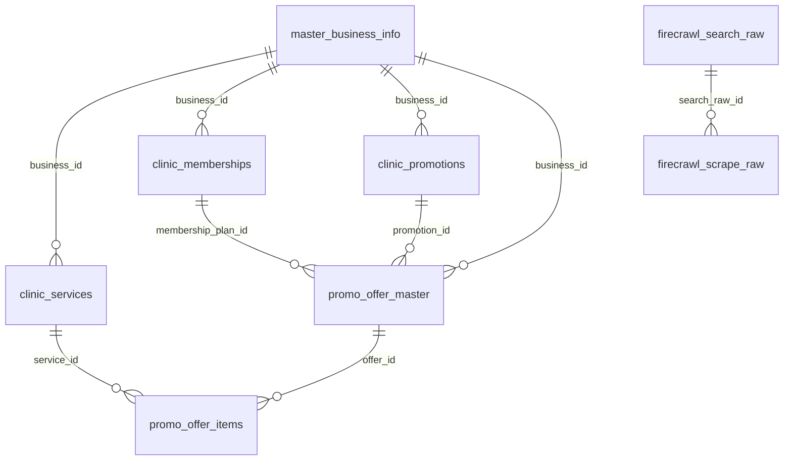

# Live data model and pipeline

This document describes the current Supabase project schema. The checked-in source of truth is [`schema/live_schema_snapshot.json`](../schema/live_schema_snapshot.json), refreshed from the live database on 2026-07-27.

## Core relationships



`master_business_info` is the clinic identity root. `clinic_services` contains ordinary service pricing; `clinic_memberships` describes program price and benefits; and `clinic_promotions` provides the source page for a campaign. A concrete offer belongs in `promo_offer_master`, with its services and quantities in `promo_offer_items`.

## Evidence-to-record pipeline

```text
master_business_info.website
  -> Firecrawl search
  -> firecrawl_search_raw
  -> Firecrawl scrape
  -> firecrawl_scrape_raw
  -> validated extraction
  -> clinic_services / clinic_memberships / clinic_promotions
  -> promo_offer_master + promo_offer_items
```

The domain pipeline is [`scripts/run_domain_architecture_pipeline.py`](../scripts/run_domain_architecture_pipeline.py); service-only discovery is [`scripts/run_clinic_services_firecrawl.py`](../scripts/run_clinic_services_firecrawl.py). Both must persist source URLs and use the raw Firecrawl tables as the recoverable evidence layer.

## Database contract

| Concern | Current tables |
| --- | --- |
| Clinic catalogue | `master_business_info`, `clinic_services`, `clinic_memberships` |
| Promotions and prices | `clinic_promotions`, `promo_offer_master`, `promo_offer_items` |
| Crawl evidence | `firecrawl_search_raw`, `firecrawl_scrape_raw` |
| Consumer workflow | `profiles`, `claims`, `business_reviews`, `promo_offer_quality_reviews` |

Older schema material under `config/sql/archive/` and `docs/superpowers/` is retained only as historical context and must not be executed against the current database.
