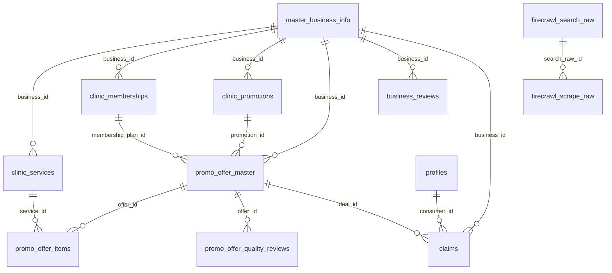

# Live data model and pipeline

This document describes CostFinder's active Supabase data model and the production ingestion path that populates it. It was verified against the live `costfinder` project on 2026-07-30.

The live database is the source of truth for field names and foreign keys. [`schema/live_schema_snapshot.json`](../schema/live_schema_snapshot.json) is the checked-in repository contract, but it can lag a live schema change; refresh it alongside future database changes rather than using it to override verified live facts. Historical schema material under `config/sql/archive/` and `docs/superpowers/` is context only and must not be executed as the current schema.

## Core relationships



`master_business_info` is the business root. An offer's commercial terms belong to `promo_offer_master`; its service composition belongs to one or more `promo_offer_items` rows. An item may have a null `service_id` until the application can resolve a reliable, same-business catalogue match.

## Public schema

### Business and normalized catalogue

| Table | Purpose | Important fields |
| --- | --- | --- |
| `master_business_info` | Clinic identity and discovery seed. | `business_id`, name, address, city, category, website, social URLs, Google place ID, logo, review metadata. |
| `clinic_services` | Normal, non-promotional service catalogue. | `service_id`, `business_id`, `service_name`, `regular_price`, `unit_type`, `service_category`, `service_area`, `source_url`, `service_raw_text`. |
| `clinic_memberships` | Purchasable membership plans and their benefits. | `plan_id`, `business_id`, `membership_name`, `membership_price`, `billing_period`, `minimum_commitment_months`, `benefits`, `source_url`. |

`clinic_services.regular_price` is a public catalogue price for the stated `unit_type`; it is nullable when a service is known but a reliable public price has not been extracted. It is not a promotional, package, or market-average price. `clinic_memberships.membership_price` is the recurring or one-time amount described by `billing_period`; `benefits` is a JSON array of plan entitlements.

### Promotions and offers

| Table | Purpose | Important fields |
| --- | --- | --- |
| `clinic_promotions` | Campaign-level source page and lifecycle. | `promotion_id`, `business_id`, `promotion_title`, `source_url`, campaign dates, `is_active`, `promotion_content`. |
| `promo_offer_master` | Offer-level price, eligibility, provenance, and activity state. | `id`, `business_id`, `promotion_id`, `membership_plan_id`, regular and discount price fields, `price_model`, membership/new-customer requirements, `offer_fingerprint`, `offer_raw_text`, `is_active`. |
| `promo_offer_items` | The service components of an offer, including a single-service offer. | `offer_item_id`, `offer_id`, `service_id`, `quantity`, `unit_price`. |

`promo_offer_master` describes the commercial offer, not a specific service. Its `price_model` distinguishes total-price, per-unit, and starting-price offers. `regular_price` and `discount_price` are the prices stated by the promotion; `discount_amount` and `discount_percent` are comparative fields when supported by evidence. `promo_offer_items` supplies the service relationship and stated quantity. A package can therefore have multiple items, while a single offer still has one item. `quantity` is recorded only when a positive quantity is explicitly stated; `unit_price` records an item-level price when available.

### Evidence and quality control

| Table | Purpose | Important fields |
| --- | --- | --- |
| `firecrawl_search_raw` | Recoverable result of each search request. | `id`, `request_fingerprint`, `search_query`, `response_json`, success and error fields. |
| `firecrawl_scrape_raw` | Recoverable scrape payload linked to its search request. | `id`, `request_fingerprint`, `source_url`, `search_raw_id`, Markdown/HTML payloads, links, metadata, OCR fields, success and error fields. |
| `promo_offer_quality_reviews` | Review queue and resolution record for offer-quality findings. | `review_id`, `offer_id`, rule name, source snapshot, proposed patch, status, resolution fields. |

The raw Firecrawl tables are the evidence layer, not an alternate catalogue. A normalized record must retain its source URL and be traceable back to the captured search or scrape material when that evidence was used. `promo_offer_quality_reviews` stores audit outcomes; it does not replace the offer itself.

### Consumer workflow

| Table | Purpose | Important fields |
| --- | --- | --- |
| `profiles` | Consumer profile associated with `auth.users`. | `id`, contact and verification fields, location, alert preferences, status. |
| `claims` | A consumer's interest in an offer and the clinic follow-up lifecycle. | `id`, `consumer_id`, `deal_id`, `business_id`, status, preferred and booked times, expiry and relay fields. |
| `business_reviews` | Scraped Google Maps review evidence for a clinic. | `id`, `business_id`, Google review ID, rating, text, media, publication time. |

Consumer claims and review ingestion are adjacent product workflows. They are not outputs of the Firecrawl price-extraction pipeline.

## Evidence-to-record pipeline

```text
master_business_info.website
  -> domain and service-page discovery
  -> firecrawl_search_raw
  -> candidate URL, domain, and price-signal gates
  -> firecrawl_scrape_raw
  -> validated extraction and normalization
  -> clinic_services / clinic_memberships / clinic_promotions
  -> promo_offer_master + promo_offer_items
  -> promo_offer_quality_reviews when a quality rule requires review
```

[`scripts/run_domain_architecture_pipeline.py`](../scripts/run_domain_architecture_pipeline.py) is the domain-level path for search, scrape, extraction, and persistence. [`scripts/run_clinic_services_firecrawl.py`](../scripts/run_clinic_services_firecrawl.py) is the service-catalogue discovery path. Both preserve search and scrape evidence independently of normalized writes.

Catalogue-price writes are guarded by [`utils/service_price_guard.py`](../utils/service_price_guard.py): promotional and blog sources, unsupported market ranges, unnormalised package totals, and mismatched sub-treatments must not overwrite `clinic_services.regular_price`. Service-to-offer matching is deterministic within the same `business_id`; uncertain matches remain unlinked rather than creating a cross-business association.

## SAG projection

`sag` is a rebuildable, server-only projection for the Structured Agentic Graph (SAG) pilot. It is not a source-of-truth business schema and must not be used to update public catalogue or promotion tables.

The pilot reads structured service, membership, and promotion records, then creates versioned `sag.document` rows. Documents are split into `sag.chunk` rows, enriched as `sag.event` and `sag.entity` records linked through `sag.event_entity`, and indexed through the corresponding chunk, event, and entity embedding tables. `sag.index_version` identifies each corpus build, while `sag.index_job` tracks asynchronous upsert or delete work.

The current project accesses SAG through server-side database connectivity used by [`scripts/sag_persistent_pilot.py`](../scripts/sag_persistent_pilot.py). It is intentionally outside client access: as verified on 2026-07-30, the `anon`, `authenticated`, and `public` roles have no `USAGE` on the `sag` schema and no `SELECT` access to its tables. RLS is not currently enabled on these private tables, so documentation must not describe SAG as RLS-protected.
